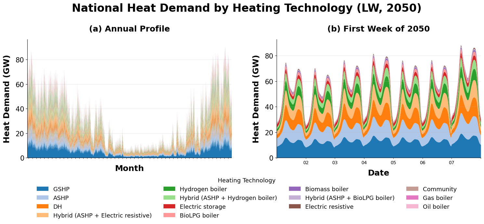
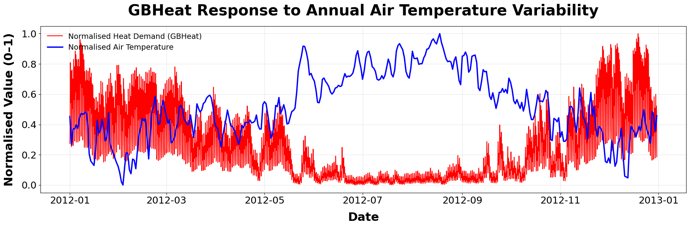
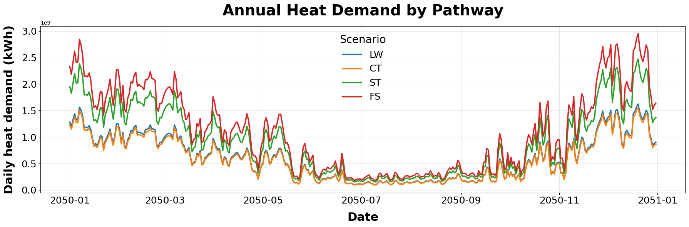
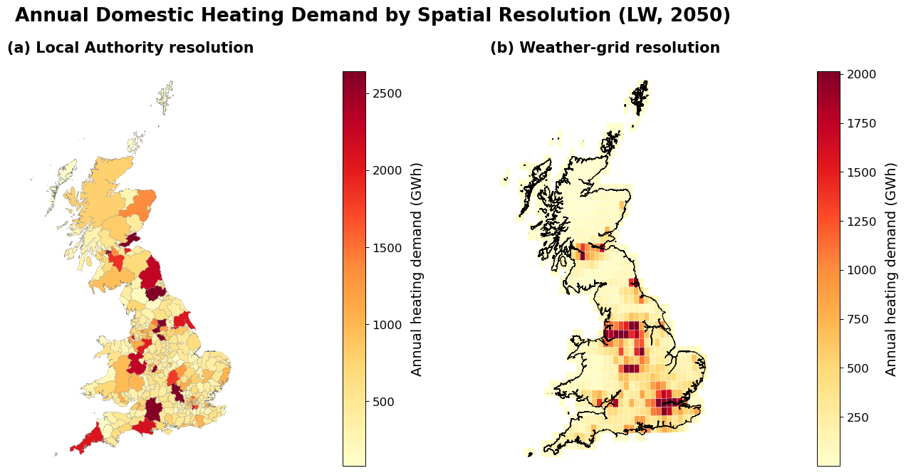
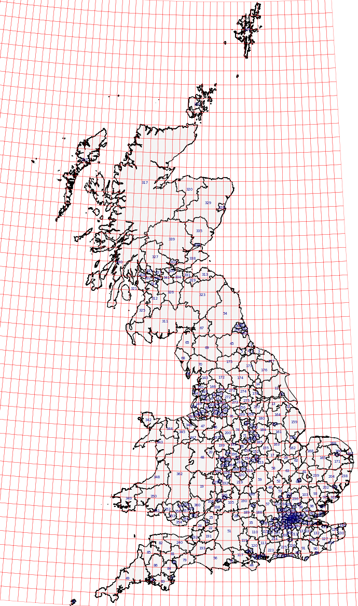
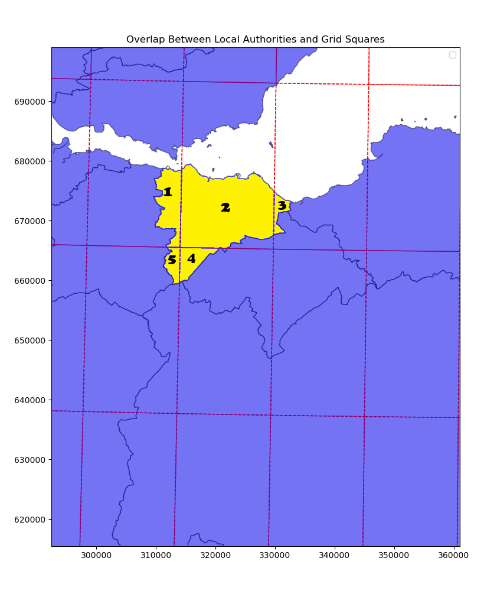

# GBHeat — High-resolution residential heat-demand modelling for Great Britain

**An open research modelling framework for half-hourly, spatially resolved residential heat and electrified-heating demand, supporting energy-system planning and electricity–heat sector-coupling studies.**

[](pyproject.toml)
[](Notebooks/README.md)
[](#release-and-reproducibility-status)

GBHeat combines **ERA5-derived weather conditions**, empirically calibrated **residential heating-use patterns**, and **Future Energy Scenarios (FES) heating-technology stocks** to create technology-resolved residential thermal-demand profiles. Temperature-dependent heat-pump coefficients of performance (COP) are used to derive associated electricity-demand profiles for supported electrified technologies. Results can be examined at weather-grid, Local Authority and national scales.

> **Scope:** GBHeat is a *demand-modelling* framework. Its outputs can inform network planning, generation adequacy, flexibility, energy-system optimisation and energy-economics research. It does **not**, by itself, solve a power-system dispatch, investment or electricity-market-clearing problem.

## At a glance

| Dimension | GBHeat coverage |
| :-- | :-- |
| Geography | Great Britain, **738 ERA5-derived weather-grid cells** |
| Administrative analysis | Local Authorities; the included LAD December 2021 GB boundary set contains **363 distinct authority codes** (see [geography note](#geography-and-methodological-notes)) |
| Time resolution | **Half-hourly** thermal and selected electrified-heating demand |
| Historical weather | **2010–2024** (15 weather years; external input data required) |
| Heating technologies | **14** heating-technology categories, including heat pumps, boilers, resistive/storage electric heating, district/community heating and hybrids |
| Transition assumptions | FES spatial heat-model vintages **2021, 2022, 2024 and 2025** supplied in this repository; pathways depend on the FES vintage |
| Heat-pump performance | ASHP/GSHP temperature-dependent COP; `current`, `good` and `very good` variants |
| Primary outputs | Technology-resolved time series, annual energy, coincident peaks, ramp rates, local–national peak coincidence and spatial maps |

## Research outputs

### Technology-resolved heating demand



*Illustrative Leading the Way (LW) 2050 thermal-demand composition. Thermal demand should not be interpreted directly as electricity consumption; COP conversion is handled separately.*

### Weather-driven variability



*Heating demand responds inversely to outdoor temperature and retains strong intraday variability.*

### Future Energy Scenarios



*Illustrative daily demand by FES pathway. Always report the specific FES data vintage, weather year and target year alongside pathway names.*

### Why spatial resolution matters



*Annual heat demand mapped at administrative and weather-grid resolutions; each panel uses its own colour scale.*

### Administrative-to-weather-grid mapping



*GB administrative boundaries and weather-grid cells used for spatial reconciliation.*

<details>
<summary>Example: intersection of an individual Local Authority with weather-grid cells</summary>



</details>

## Selected findings from the accompanying manuscript

The figures and values below are **research results from the supplied manuscript**, not automated regression-test guarantees for this checkout.

| Case study | Annual heat demand | Coincident peak | Maximum ramp rate |
| :-- | --: | --: | --: |
| LW 2050, without FES demand scaling | 537.15 TWh | 221.55 GW | 26.86 GW/h |
| LW 2050, with FES demand scaling | 222.77 TWh | 91.88 GW | 11.14 GW/h |
| Watson et al. benchmark | 422.0 TWh | 157.0 GW | 21.0 GW/h |
| GBHeat aligned to Watson benchmark | 445.0 TWh | 172.8 GW | 22.87 GW/h |

In the aligned Watson comparison, GBHeat estimates approximately **5.5% higher annual heat demand**, **10.1% higher national peak** and **8.9% higher maximum ramp rate**, reflecting the use of spatially differentiated weather-grid temperatures rather than a single national temperature series. The manuscript also reports that the **highest-contributing 10% of weather-grid cells supply 58.7%** of GB coincident peak heating demand.

These figures depend on the assumptions and scenarios in the manuscript; they are **not universal GB heat-demand estimates**.

## How GBHeat works

```text
ERA5-derived air temperatures             FES Local Authority heating stocks
               |                                        |
Temperature-dependent daily demand          Harmonise LAD geography
+ behavioural profiles                      + allocate stocks across grids
               |                                        |
               +---------- 738 weather-grid cells ------+
                                      |
                       Technology-specific half-hourly
                            THERMAL heat demand
                                      |
                         ASHP / GSHP COP profiles
                                      |
                     Supported electrified-heating loads
                                      |
                 National analysis / Local Authority analysis
                                      |
                  Peak coincidence, ramps, maps, exports
                                      |
                     External energy-system modelling
```

The empirical heating-use patterns are **daytime, bi-modal and continuous**, based on published Watson et al. work. At the technology level, GBHeat weights these temperature-sensitive patterns by the number of dwellings assigned to each heating technology. The FES scaling factor adjusts aggregate demand for future scenario assumptions.

See the [manuscript and methodology](#research-paper-and-citation) and [Notebook guide](Notebooks/README.md) for details.

## Getting started

### 1. Clone and install

```bash
git clone https://github.com/Lavinjafari/GBHeatModel.git
cd GBHeatModel
python -m pip install -e ".[notebooks]"
jupyter lab
```

Installation uses the **local repository**, not a package published to PyPI. Select the Jupyter kernel belonging to the environment in which you installed `gbheatmodel`.

### 2. Obtain the required model data

The repository contains the smaller reference inputs (FES spatial heat-model tables, LAD boundaries, grid geometry, lookup tables and spatial operators). To run the full model you must also provide large datasets in their existing expected locations:

```text
data/
├── FES_Spatial_Heat_Model/          # tracked reference inputs
├── LAs_shapefile_2021/              # tracked geometry
├── Scenario_Alignment/              # tracked custom-scenario baseline
├── spatial_operators/               # tracked operators
├── UK_Atlite_Grid_sq.gpkg           # tracked grid geometry
├── air_temp/                        # external weather-derived data
├── Atlite/                          # external raw weather/Atlite data
├── heat_demand_profiles_patterns/   # external pattern-profile library
└── outputs/                         # generated locally, Git-ignored
```

**Data access status:** The manuscript describes Zenodo distribution, but a verified final DOI/download command was **not present** in the supplied repository. No downloader is claimed to be functional here. Until a versioned Zenodo release is available, obtain the input data from the maintainers and preserve the folder structure. See [data/README.md](data/README.md) for a detailed inventory and availability notes.

### 3. Run your first FES scenario

Open [`Notebooks/01_Heat_Demand_Profiles.ipynb`](Notebooks/01_Heat_Demand_Profiles.ipynb) and set the notebook configuration, for example:

```python
weather_year = 2010
future_year = 2050
FES_year = "2022"
FES_scenario = "LW"
```

The equivalent existing Python entry point is:

```python
from gbheatmodel.runner import run_heat_profiles_only

profiles = run_heat_profiles_only(
    weather_year=2010,
    future_year=2050,
    FES_year="2022",
    scenario="LW",
)
```
- [FES data compatibility (2021–2025)](docs/fes-data-compatibility.md) — Supported FES releases, scenario identifiers, heating technologies and compatibility notes.
This is a **full grid-level calculation** and requires the external heating-pattern data. It is not intended as a lightweight, data-free quickstart.

### 4. Derive heat-pump COP and heating electricity demand

Use [`Notebooks/02_COP_and_Electricity_Demand.ipynb`](Notebooks/02_COP_and_Electricity_Demand.ipynb) with the same scenario settings. The implemented electricity-conversion workflow currently covers **ASHP, GSHP and three hybrid types**; this is not a complete all-electric-heating or national electricity-load model.

## Notebook workflows

| Notebook | Workflow |
| :-- | :-- |
| [01 · Heat demand profiles](Notebooks/01_Heat_Demand_Profiles.ipynb) | Run the reference technology-resolved thermal demand model |
| [02 · COP and electricity demand](Notebooks/02_COP_and_Electricity_Demand.ipynb) | Convert supported thermal demand to heating-electricity requirements |
| [03 · National demand analysis](Notebooks/03_National_Demand_Analysis.ipynb) | Aggregate saved profiles, analyse peaks and national demand |
| [04 · Local Authority heat demand](Notebooks/04_Local_Authority_Heat_Demand.ipynb) | Allocate saved demand to LAD 2021 boundaries; audit conservation |
| [05 · GBHeat figures](Notebooks/05_GBHeat_Figures.ipynb) | Produce publication-style figures from saved results |
| [06 · Custom scenarios and benchmarks](Notebooks/06_Custom_Scenario_and_Benchmark_Comparison.ipynb) | Define a custom RHPP-based dwelling scenario and compare national profiles with published benchmarks |

**Standard workflow:** 01 → 02 → 04 (for LA outputs) → 03 → 05. Notebook 03 may run earlier if only grid/national outputs are required. Notebook 06 is an **optional, separate benchmark/custom-scenario workflow**; its current RHPP total-heat calculation should not be mistaken for the main model's full technology-specific FES calculation.

Read [Notebooks/README.md](Notebooks/README.md) for settings, output schema, prerequisites, usage restrictions and checks.

## Example outputs and units

Default generated files are written under `data/outputs/` and are excluded from Git. Typical outputs include:

```text
data/outputs/
├── heating_profiles/<weather>_<FES vintage>_<pathway>_<future year>/
├── COP_Profiles/
├── electric_demand/<weather>_<FES vintage>_<pathway>_<future year>/
├── LA_heat_profiles/<run_id>/<allocation_method>/
└── figures/<run_id>/
```

The modelling CSV time series contain **kWh per 30-minute interval**. Convert to mean power using `GW = (kWh per half-hour) × 2 / 1e6`. National coincident peak is the **maximum of the sum of all grid demand at a common timestep**, not the sum of individual grid maxima. For annual energy, `TWh = sum(kWh) / 1e9`.

## Geography and methodological notes

The **supplied manuscript describes 371 Local Authorities**, but the **included December 2021 GB boundary dataset and the validated Notebook 04 workflow cover 363 LAD 2021 codes**. The discrepancy must be reconciled before the manuscript and repository are presented as using identical LA coverage. Do not silently substitute either count; report the geography and vintage actually used for a run.

Other limitations: empirical demand regressions can under-represent residual summer domestic hot-water demand; the model does not separate space heat from domestic hot water; stock redistribution is spatially resolved but not dwelling-resolved; and electricity conversion is limited to the technologies implemented. Full details appear in the accompanying manuscript.

## Applications in energy systems and energy economics

GBHeat outputs can be used to study:

- Local and national **demand peaks**, coincident loading and infrastructure reinforcement.
- **Heat electrification** under alternative FES decarbonisation pathways.
- **Flexibility** and storage needs associated with cold-weather heating peaks.
- Sensitivity of system loading to **weather years** and heating-technology deployment.
- **Sector coupling** by providing geographically and temporally differentiated heating-electricity inputs for external power-system models (including PyPSA-based workflows).
- Downstream **economic assessments** of network congestion, locational prices, investment and system costs when coupled to appropriate optimisation/market models.

The last two applications require separate system modelling; they are not precomputed economic results supplied by this repository.

## Research paper and citation

**Z. Jafaripour, D. Friedrich and A. Lyden**, *From local profiles to national peaks: High-resolution spatiotemporal modelling of residential heat demand in Great Britain*. Manuscript supplied with this repository preparation; publication status and persistent identifier to be added when available.

Please cite both the research paper (once published) and the version/DOI of any Zenodo datasets used. A `CITATION.cff` file can be finalised once the author-preferred citation, version and DOI are confirmed. Do not use a placeholder DOI as a real citation.

The modelling methods draw on Watson et al. (2021, 2023), ERA5 reanalysis and NESO Future Energy Scenarios, as credited in the manuscript.

## Release and reproducibility status

**Pre-release research software.** The notebook workflows have not been independently verified end-to-end on a fresh environment with separately downloaded inputs. Before a tagged scientific release, see [RELEASE_CHECKLIST.md](RELEASE_CHECKLIST.md) for unresolved package, data, tests, provenance and licence checks. An explicit repository software licence has not been identified in the supplied archive; **do not assume a licence until one is selected and committed**.

## Maintainers and contributions

Developed within the **Institute for Energy Systems, School of Engineering, University of Edinburgh**. For questions, reproducibility reports and code improvements, use [GitHub Issues](https://github.com/Lavinjafari/GBHeatModel/issues). Please include your weather year, FES vintage, scenario, Python environment and a minimal error trace when reporting a problem.
