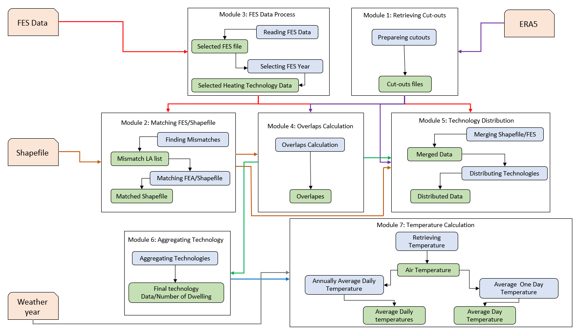
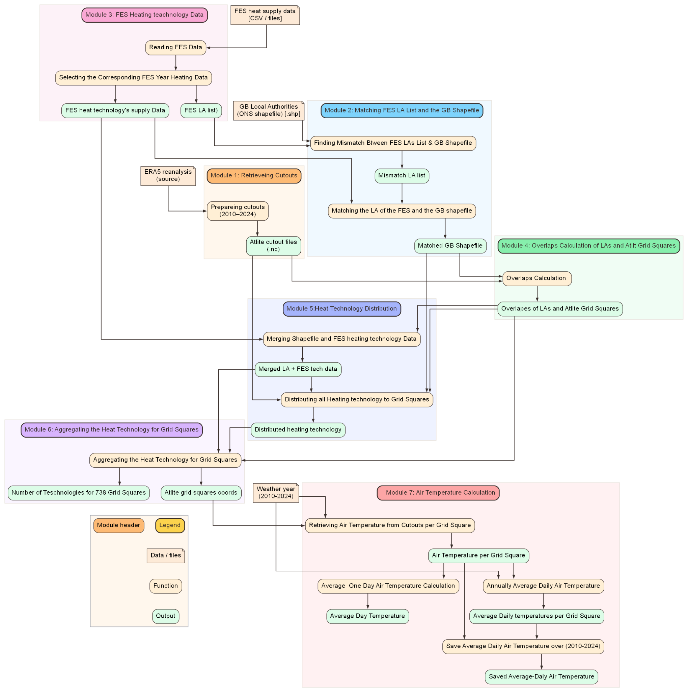
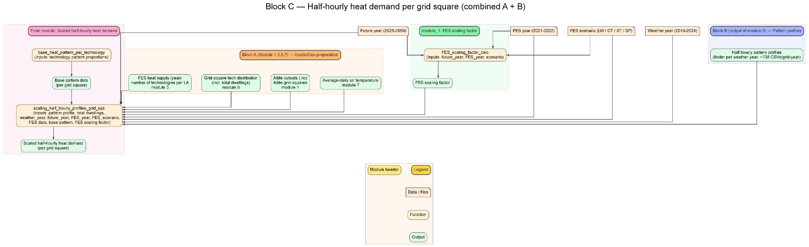

# GBHeat architecture and data flow

GBHeat is a weather-driven, spatially explicit model for half-hourly **residential thermal heat demand** and derived **electric heating demand** in Great Britain. This document explains the input preparation and technology-allocation stages illustrated by the original project diagrams. For the thermal-profile equations, see [Methodology](methodology.md); for executable examples, see the [notebooks](../Notebooks/README.md).

> **Scope:** These diagrams document the conceptual and historical module organisation. Their original module labels are preserved, but they are not guaranteed to match current Python function names or execution order in `src/gbheatmodel/`. The code and the published manuscript remain authoritative for implementation and scientific assumptions.

## Model blocks

| Block | Purpose | Main inputs | Outputs |
| --- | --- | --- | --- |
| **A — input and spatial preparation** | Harmonise FES Local Authority heating stocks with geographic boundaries; identify weather-grid overlaps; allocate and aggregate stocks by grid cell; prepare temperatures | FES spatial heat data, LA boundaries, ERA5/Atlite weather-grid geometry, weather year | Heating-technology stocks for weather-grid cells; weather-derived temperature data |
| **B — heating-use-pattern profiles** | Compute temperature-dependent household heating demand using daytime, bi-modal, and continuous usage patterns | Daily air temperature, regression coefficients, normalised half-hourly profiles | Half-hourly **per-dwelling** heating-use-pattern profiles by grid cell |
| **C — final heat demand** | Combine spatial heating-technology stock with pattern-specific demand and scenario-dependent scaling | Outputs of A and B; FES scenario/year and demand-scaling assumptions | Half-hourly thermal heat demand by heating technology and grid cell |
| **Downstream conversion** | Compute heat-pump COP and electricity requirements for implemented electrified systems | Thermal heat-demand profiles and temperature-dependent COP assumptions | Technology-resolved electric heating-demand profiles |

The manuscript describes the overall framework as input preparation, temperature-driven profile generation, heat-demand calculation, COP calculation, and electricity-demand conversion. The more granular module names shown in the supplied diagrams are an implementation-level view of those stages.

## Block A — input data and spatial preparation

*Figure A1. High-level view of the FES, administrative-boundary, weather-cutout, technology-allocation, and temperature-processing steps. Original figure supplied by the project author.*

The detailed workflow includes reading the selected FES data vintage and year; reconciling its Local Authority identifiers with the shapefile; preparing ERA5-derived Atlite cutouts; calculating Local Authority/weather-grid intersections; distributing technology stocks; aggregating by weather-grid cell; and retrieving daily temperatures. **Stocks are spatially allocated before weather-driven demand is calculated.**

*Figure A2. Detailed Block A data inputs, functions, and intermediate outputs. Original module numbering and names have been retained.*

The geographic overlap shares provide the bridge between Local Authority stock projections and the 738 weather-grid cells. Weather inputs are used to generate temperature-driven profiles; they do not replace the FES stock distribution.

## Block B — heating-use-pattern demand

Block B produces the reusable half-hourly profiles for the three heating-use patterns. See the [detailed Block B diagram](methodology.md#block-b--half-hourly-heating-use-pattern-profiles) and the corresponding scientific formulation in the manuscript.

## Block C — technology-resolved heat demand

*Figure C1. Integration of Block A technology stocks, Block B temperature-dependent profiles, future-year assumptions, and the FES scaling factor. Original figure supplied by the project author.*

The core thermal output is generated by weighting the three precomputed heating-use-pattern profiles according to the selected technology, multiplying by the number of dwellings assigned to that technology and grid cell, then applying the applicable future-scenario demand scale. The precise code and currently supported FES vintages should be checked against the release being run.

## Inputs and generated results

- **Tracked reference inputs:** selected FES spatial tables, compatible boundaries and spatial reference/lookup files where redistribution rights permit.
- **External datasets:** larger precomputed weather and heating-pattern inputs; their Zenodo identifiers and file checksums must be published when deposits are finalised.
- **Generated results:** `data/outputs/` contains local thermal profiles, COP profiles, electrical demand, LA redistributions, diagnostics and figures. It should remain Git-ignored.

Do not interpret any diagram as evidence of a working data downloader, end-to-end tested release, or a separate cost-optimisation engine. GBHeat produces demand profiles that can be used in downstream energy-system, network and energy-economics studies.

## Reproducibility and current implementation

Start with [Notebook 01](../Notebooks/01_Heat_Demand_Profiles.ipynb) for thermal profiles, then [Notebook 02](../Notebooks/02_COP_and_Electricity_Demand.ipynb) for COP/electricity conversion. [Notebook 04](../Notebooks/04_Local_Authority_Heat_Demand.ipynb) provides stock-informed LA redistribution of saved grid results. For architecture changes, update the diagrams and the code-facing documentation together.
