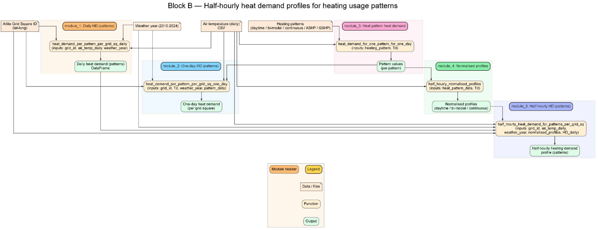
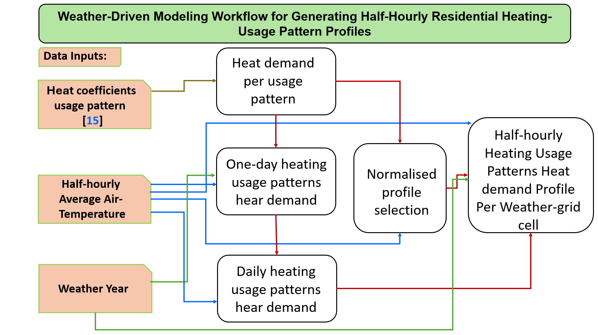

# GBHeat methodology — weather-driven heating-use profiles

This document accompanies the original Block B workflow figures. It describes how **temperature-dependent residential demand per dwelling** is constructed and then used by the final heating-demand stage. See [Architecture](architecture.md) for Blocks A and C and [Notebook 01](../Notebooks/01_Heat_Demand_Profiles.ipynb) for the main executable pipeline.

> **Scientific source:** *From local profiles to national peaks: High-resolution spatiotemporal modelling of residential heat demand in Great Britain* (Jafaripour, Friedrich and Lyden; supplied preprint). This documentation follows the model description in Sections 2.3–2.6; it does not replace the paper's detailed calibration and references.

## Block B — half-hourly heating-use-pattern profiles



*Figure B1. Original detailed workflow: daily pattern demand, one-day profiles, selection of temperature-dependent normalised profiles, and half-hourly per-grid-cell outputs.*

The three empirical usage classes are **daytime**, **bi-modal**, and **continuous**. For each weather-grid cell and weather year, GBHeat uses temperature-dependent empirical relationships to estimate daily domestic heat demand per dwelling, then distributes that daily energy over the 48 half-hourly intervals using the relevant normalised intraday profile.



*Figure B2. Compact weather-driven pattern calculation. Original image retained without visual modifications; the source image contains the typo “hear demand”, meaning “heat demand”.*

### Daily demand

For usage pattern `p` and mean daily outdoor temperature `T_d`, the adopted broken-stick regression has the form

```text
HD_p(T_d) = m1,p * T_d + c1,p,  when T_d < T_break,p
          = m2,p * T_d + c2,p,  otherwise
```

`HD_p(T_d)` is a **daily energy quantity per dwelling**, not grid-scale power. The calibrated coefficients and breakpoints come from the empirical models adopted by GBHeat; do not substitute generic values.

### Half-hourly disaggregation

The temperature band determines a 48-step normalised intraday profile `P_p,t(T_d)`, satisfying `sum_t P_p,t = 1` over one day. The model constructs

```text
HD_p,t = P_p,t(T_d) * HD_p(T_d)
```

for each of the three usage patterns. The resulting per-dwelling profiles are reusable across different housing-stock allocations and FES technology pathways for the same meteorological inputs.

## Block C — combining technology stocks and usage patterns

For grid cell `g`, heating technology `k` and half-hour `t`, the paper's method can be written as

```text
HD_g,k,t = N_g,k * (
    w_k,daytime    * HD_g,daytime,t
  + w_k,bi-modal   * HD_g,bi-modal,t
  + w_k,continuous * HD_g,continuous,t
)

HD_scaled_g,k,t = SF_year,scenario * HD_g,k,t
```

where `N_g,k` is the number of dwellings assigned to heating technology `k` in grid cell `g`, `w` are technology-specific usage-pattern shares that sum to one, and `SF` is the chosen FES demand-scaling factor. **Thermal heat demand is calculated before electricity conversion.**

The supplied manuscript states the following example usage-pattern coefficients:

| Heating technology group | Daytime | Bi-modal | Continuous |
| --- | ---: | ---: | ---: |
| Gas boiler and gas-like technologies | 0.46 | 0.34 | 0.20 |
| ASHP | 0.30 | 0.09 | 0.61 |
| GSHP | 0.21 | 0.05 | 0.74 |
| Electric storage | 0.00 | 0.00 | 1.00 |
| Hybrid (ASHP + electric resistive) | 0.46 | 0.34 | 0.20 |

These coefficients describe a model assumption, not measured shares for every heating technology. Consult the source implementation for the full technology mapping.

## Downstream COP and electricity demand

The main model subsequently estimates ASHP/GSHP COP from daily outdoor temperature and converts the relevant thermal demand into electrical heating load. Hybrid systems use the heat-pump and backup-technology shares implemented by the model. **GBHeat does not by itself calculate electricity-market prices or investment costs.**

## Temporal units and interpretation

- Thermal-profile output represents **kWh per half-hour interval**.
- National annual energy in **TWh** is `sum(kWh) / 1e9`.
- Mean power during an interval in **GW** is `2 * kWh / 1e6`.
- The coincident national peak is the maximum of the sum of grid demand at the **same timestep**, not the sum of each grid's own maximum.

## Scope and limitations

The empirical domestic heat demand combines space heating and domestic hot water; the current formulation does not independently simulate those components. The adopted demand scaling is an aggregate adjustment rather than a building-physics model of insulation upgrades. The supplied diagram labels reflect earlier module organisation and require an implementation check before being used as a software API reference.
